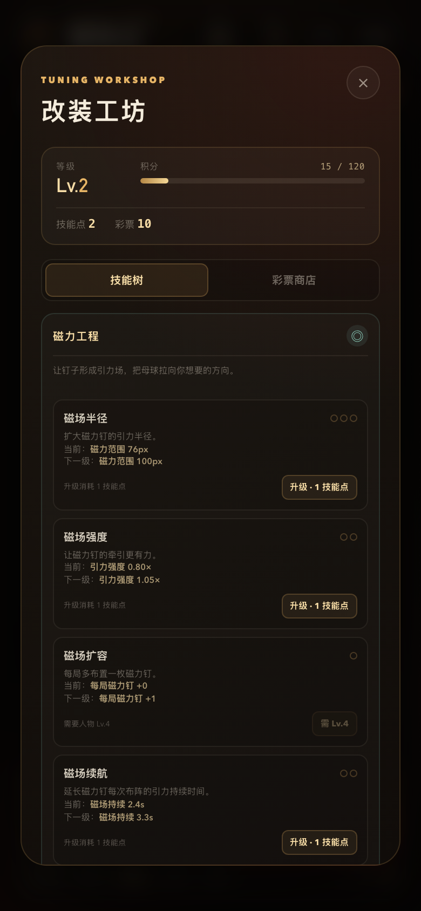
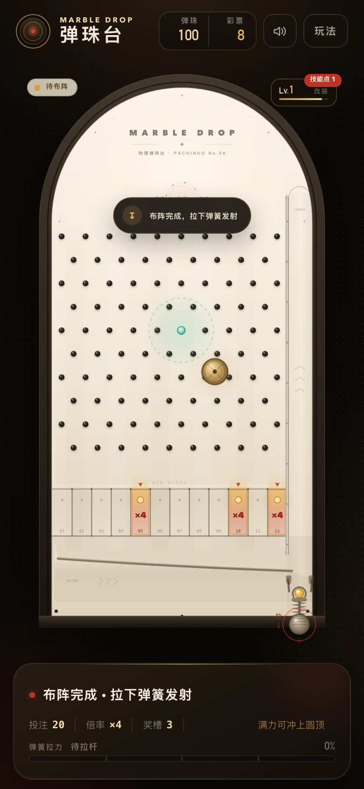
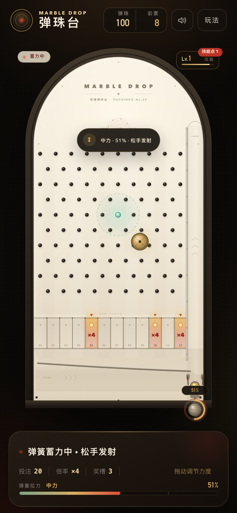
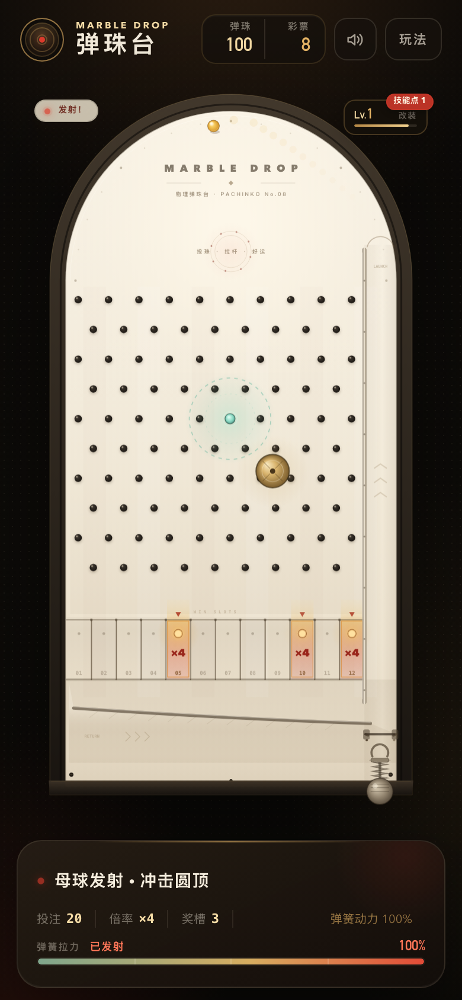

# 弹珠台 · MARBLE DROP

一个竖屏物理弹珠台小游戏，纯 HTML / CSS / Canvas 实现，无第三方依赖。


## 运行

直接双击 `index.html` 即可游玩，或者启动一个本地静态服务器：

```bash
cd 弹珠游戏
python3 -m http.server 4173 --bind 127.0.0.1
```

然后打开 <http://127.0.0.1:4173/>。

也可以使用：

```bash
npm start
```

## 玩法

1. 在底部选择本局投入 **5–99 颗弹珠**，按「开始游戏」。
2. 系统随机抽出一个倍率，并点亮对应的中奖槽位：
   - ×2：4 个中奖槽
   - ×4：3 个中奖槽
   - ×6：2 个中奖槽
   - ×8：1 个中奖槽
   - ×10：1 个中奖槽
3. 开始后限位器打开，母球落入右下发射舱。
4. **按住弹簧把手向下拖动，松手发射**。拖动时底部力度条会线性显示 **弱力 / 中力 / 强力 / 满力**；拉力越大，发射速度越快；满力可冲到圆顶最高点，再回落穿过钉子阵。
5. 母球落入底部 12 个槽位之一。如果落入亮灯槽：
   - 返还「本局投入 × 当前倍率」颗弹珠。
   - 每满 30 颗返还弹珠，额外获得 1 张彩票（例如 60 颗 = 2 张）。
6. 母球沿底部回球坡道滑回限位器，完成一局循环，可以开始下一局。

初始拥有 100 颗弹珠，新档还会赠送 1 技能点，可立即体验一次机关强化。余额少于 5 颗时，底部会出现「补给 +100」按钮。余额、彩票、音效设置、当前投入、等级和收藏都会保存在浏览器本地。

## 成长与机关

每局结束会获得积分：落槽基础分 + 中奖分 + 机关得分。积分达到逐级提高的关卡门槛后升级，每次升级获得 **1 技能点**。

点击机台右上角的 **Lv. 徽章** 打开「改装工坊」；点击顶部 **彩票数字** 会直接进入彩票商店。

- **磁力工程**：磁力钉，可强化引力半径、引力强度、磁场持续时间和每局数量
- **弹力工程**：弹力板，可强化接触半径、反弹强度和每局数量
- **技能点**来自升级，用于永久强化机关
- **彩票商店**出售一次性磁力钉、一次性弹力板，以及母球外观皮肤

发射前先点击下方「磁力钉 / 弹力板」机关按钮，再点击机台对应位置布阵；也可以直接拉杆跳过布阵。每局有基础机关次数，商店购买的一次性机关会在使用时额外消耗。




布阵示意：



## 目标循环

1. 每一局获得积分和经验
2. 升级获得技能点，强化磁力/弹力机关
3. 用更好的机关构筑挑战更高返还
4. 用彩票购买一次性机关和外观
5. 继续升级、收集和强化机关

## 操作

- **鼠标 / 触摸**：按住右下角弹簧把手向下拖动，底部会实时显示 0–100% 拉力和力度等级，松手发射；接近满力时会自动吸附到 100%。
- **力度反馈**：每跨过 25% 力度刻度，会触发轻微触感和提示音；松手后力度条保留本局发射力度。
- **发射前布阵**：点击底部「磁力钉 / 弹力板」按钮，再点击机台放置。也可以直接拉杆跳过。
- **改装工坊**：点击机台右上角 `Lv.` 徽章打开技能树；点击顶部 `彩票` 数字直接进入彩票商店。
- **键盘**：在待发射状态按住 `空格` 蓄力，松开空格发射；空闲时按 `Enter` 开始。
- 右上角可以关闭音效；「玩法」里可以查看规则、重置进度。

力度调节示意：



满力冲顶示意：



## 实现说明

- 使用 Canvas 2D 绘制机台、灯光、球体、粒子和回球动画。
- 自研轻量 2D 物理：固定 240Hz 物理子步，处理圆与线段、圆与圆碰撞，带重力、弹性、摩擦和微小钉面散射。
- 钉子改为左右对称的 10/9 交错三角阵，两侧边缘留出相同间距，避免一侧直落、另一侧堵死；十排钉阵覆盖到槽口上方，让落点更均匀。
- 弹簧拉力与发射速度采用线性映射，配合实时力度条、力度等级和触感刻度，手机上也能细调弱力到满力。
- 新增积分/等级/技能点成长线、磁力钉与弹力板两套机关、改装工坊和彩票商店。
- 发射通道只保留竖直导轨，母球冲顶后直接由圆顶反弹进入钉子阵；弹簧力度越大，发射速度越快，可达的反弹范围越远。
- 中奖槽由随机倍率配置生成，物理结果完全由实际碰撞落点决定。
- 纯前端，无构建步骤；`js/game.js` 内含仅用于调试的 `window.__MARBLE_DROP__` 接口。

## 文件结构

```text
.
├── index.html       页面结构与 HUD
├── styles.css       竖屏布局、控制台、弹窗与动效
├── js/game.js       物理、游戏流程、Canvas 渲染、音效
├── preview.png           游戏预览截图
├── preview-controls.png  力度条与弹簧控制示意
├── preview-full-power.png 满力冲顶示意
├── preview-tools.png     磁力钉 / 弹力板布阵示意
├── preview-workshop.png  改装工坊技能树
├── preview-shop.png      彩票商店
├── package.json
└── README.md
```

## 第一阶段范围

当前版本已实现：

- 积分、等级、技能点和本地存档
- 磁力钉、弹力板两种可布置机关
- 磁力半径 / 强度 / 持续时间 / 数量升级
- 弹力板半径 / 反弹强度 / 数量升级
- 彩票商店：一次性机关、鎏金母球、青玉母球

后续阶段计划加入：

- 分裂球、玻璃球等特殊球物理
- 可击碎挡板、彩洞标记
- 更多球材质与机关类型
- 每日挑战、连胜记录和本地排行榜

## 兼容性

面向现代桌面与移动浏览器（Chrome、Safari、Edge）。Canvas 使用 2× 内部分辨率，适配 Retina / 高 DPI 屏幕。
