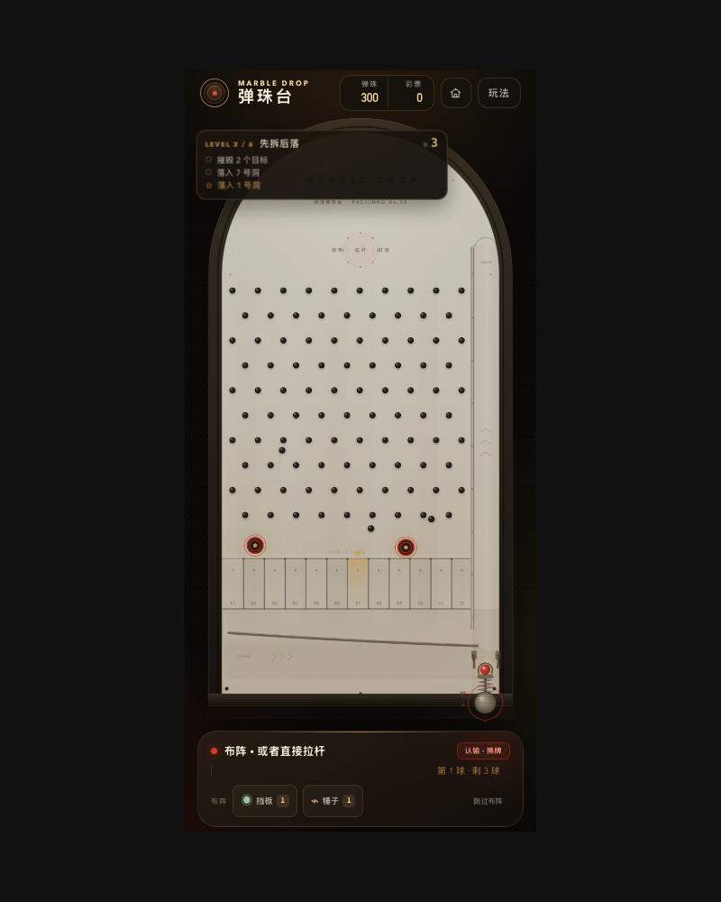
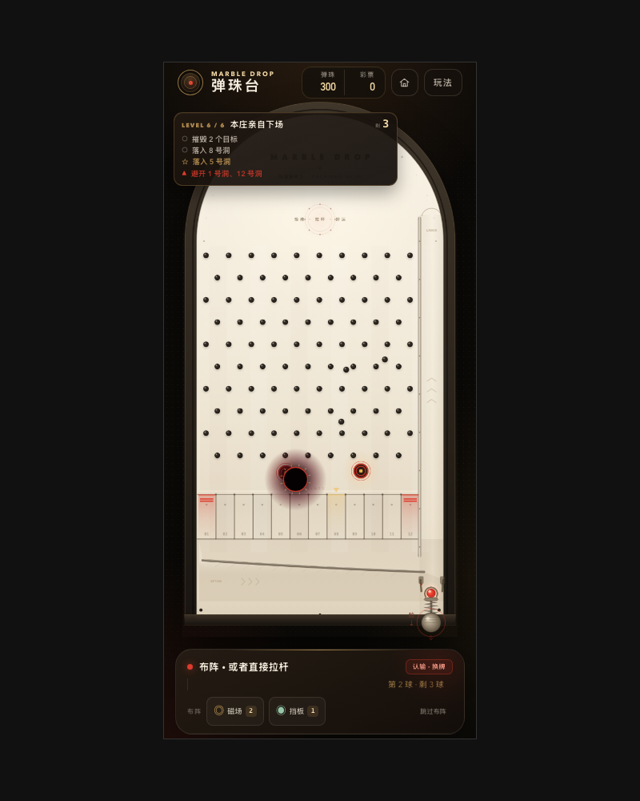
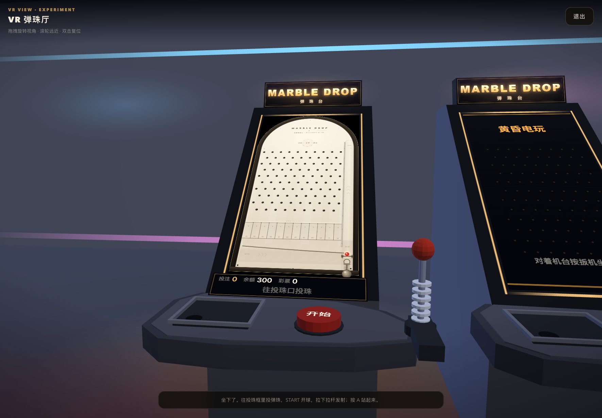

# 弹珠台 · MARBLE DROP

竖屏物理弹珠台小游戏。当前版本围绕 **街机模式** 重建了主界面、游戏币经济、商店和选项，加入可解锁的 **母球皮肤** 系统与 **可购买 / 装备的多台弹珠台**。不同机台拥有独立外观、机柜造型和专属障碍物，包括循环移动、主动 / 被动旋转、弹射、传送门，以及「狂赌深渊」中央的十二格命运轮盘。

**在线试玩：** <https://pepe-2026-coder.github.io/marble-drop/>

**GitHub 仓库：** <https://github.com/pepe-2026-coder/marble-drop>


## 当前状态

- **街机模式**：已开放。进入街机模式后可选择 **继续** 未完成的一局，或开始 **新游戏**。新游戏从 300 / 500 / 1000 颗弹珠中选择开局数量，弹珠从个人余额转入本局，游戏中不能追加；所有弹珠用完或提前结束后结算，展示 **最高持有弹珠** 与 **获得彩票数**。
- **闯关模式**：已开放。庄家「七爷」坐庄，六关连闯：精准落点、破坏目标、庄家亲自下场。失败没有资源惩罚，重开回到同一副牌，认输则换牌面但规则不变。
- **商店**：已开放彩票 / 游戏币 / 弹珠兑换，母球皮肤与弹珠台机台的购买和装备。
- **弹珠台机台**：5 台机台可购买 / 切换。「橡木经典」免费；「黄昏电玩」14 彩票；「霓虹都市」28 彩票；「虫洞实验室」40 彩票；「狂赌深渊」58 彩票。投注范围与 12 个奖槽全机台共享；单局普通彩票上限从 3 张起步，每多解锁一台机台所有机台 +1，狂赌深渊轮盘额外加减的彩票不受上限限制。
- **障碍物引擎**：支持沿路径循环移动、主动常转 / 被动受击旋转、碰撞弹射、双向传送门、静态方块和感应式转盘六类障碍物。
- **母球皮肤**：6 款皮肤，用彩票解锁；同时改变母球外观、速度拖尾、碰撞粒子和发射 / 碰撞音效，不影响物理属性。
- **选项**：音效音量、静音、触感反馈、中奖吐珠动画、玩法说明和重置存档。
- **退出**：进入退出页并尝试关闭页面；浏览器通常会阻止自动关闭标签页，页面会提示手动关闭或重新进入。

## 运行

项目没有运行时第三方依赖，使用原生 ES Modules。**必须通过 HTTP 打开**，不能直接双击 `index.html`（浏览器会阻止模块加载）。

```bash
npm start
```

然后打开 <http://127.0.0.1:4173/>。

没有 npm 时也可以：

```bash
python3 -m http.server 4173 --bind 127.0.0.1
```

### 在头显里测试 VR

WebXR 只接受安全上下文，局域网下的 `http://192.168.x.x` 进不了 VR（页面仍可当桌面预览用）。项目自带一个无依赖的 HTTPS 开发服务器：

```bash
./scripts/make-cert.sh          # 生成自签证书，包含当前局域网 IP
HOST=0.0.0.0 PORT=4174 npm start
```

启动后终端会打印 `https://<局域网 IP>:4174/`。在 Quest / Pico 浏览器里打开它，遇到「连接不是私密连接」时点“高级 → 继续前往”，再进入 选项 → VR 显示 → 进入 VR。

证书只用于本地开发，`scripts/certs/` 已在 `.gitignore` 中。换网络或 IP 变化后重新运行 `./scripts/make-cert.sh` 即可。

开发检查：

```bash
npm run check
```

## 街机模式

1. 点击主界面的「街机模式」，选择 **继续游戏** 或 **新游戏**。有进行中的一局时，「继续」会恢复该局的本局弹珠、最高纪录和已获得彩票。
2. 新游戏从 **300 / 500 / 1000 颗** 中选择开局数量。所选弹珠会从个人余额转入本局，开始后不能追加；个人弹珠不足时可用商店兑换或领取开局补助。
3. 每球投入 5–99 颗本局弹珠，随机抽出本局倍率并点亮中奖槽位：
   - 基础机台：×2（5 个奖槽，46%）、×4（3 个奖槽，34%）、×6（2 个奖槽，20%）
   - 其他机台：×2（4 槽）、×4（3 槽）、×6（2 槽）、×8（1 槽）、×10（1 槽）
4. 限位器打开，母球落入右下发射舱。按住弹簧把手向下拖动，松手发射；最低力度刚好越过发射通道顶部，最高力度把母球送得更远。
5. 母球落入 12 个槽位之一；落入亮灯槽即返还「投入 × 倍率」颗弹珠。落点由实际物理碰撞决定。
6. 中奖后播放吐珠动画：返还多少颗，就有多少颗弹珠从黄铜吐珠管落进托盘，每颗都有独立重力、托盘碰撞和落珠音效。托盘弹珠全部落定后显示本局结果卡；轻触机台可提前跳过动画。
7. 每满 30 颗返还弹珠获得 1 张彩票。单局普通彩票上限从 **3 张** 起步，每多解锁一台机台，所有机台的上限 **+1**；狂赌深渊轮盘加减的彩票不占这个上限。
8. 母球沿回球坡道回到限位器，进入下一局。装备「狂赌深渊」时，落入中央轮盘的母球会被吞入，按转盘结果改写本局倍率、彩票和追加球，然后从轮心随机角度重新射出。
9. 本局弹珠不足 5 颗时自动进入 **结算页**，展示最高持有弹珠、获得彩票数、开局数量、返还个人余额和游玩局数；剩余弹珠返还个人账户。
10. 也可以在发球前点「结束游戏」提前结算，剩余弹珠同样返还个人。右上角房子按钮可暂停并返回主界面，进度会保留，之后从街机模式继续。

吐珠动画可以在「选项 → 中奖吐珠动画」关闭，关闭后中奖会直接显示本局结果卡。


闯关模式的台面：目标洞在洞口发光，可破坏目标是同心圆靶，庄家的筹码指向他要你做的事。





## 闯关模式

闯关模式是另一套入口：不消耗弹珠、不产生返还，只考验落点和布阵。庄家「七爷」出题，玩家拆题。

### 关卡与目标

六关走完整条情绪弧线：**引导（1–2）→ 施压（3–4）→ 疯狂（5–6）**。

| 关 | 名称 | 模板 | 球数 | 目标 |
| --- | --- | --- | --- | --- |
| 1 | 第一课 | 精准 | 5 | 落入 4–6 号洞（奖励：10–12 号洞） |
| 2 | 两处落脚 | 精准 | 6 | 落入 3–5 号洞 + 9–11 号洞 |
| 3 | 先拆后落 | 破坏 | 5 | 摧毁 2 个目标 + 落入 7–9 号洞 |
| 4 | 边角生意 | 精准 | 6 | 落入 2–5 号洞，避开 10–11 号洞 |
| 5 | 三枚筹码 | 破坏 | 6 | 摧毁 3 个目标 + 落入 8–10 号洞，避开 4 号洞 |
| 6 | 本庄亲自下场 | BOSS | 6 | 摧毁 2 个目标（耐久 2）+ 落入 7–9 号洞，避开 1、12 号洞，庄家作弊三次 |

- **必选目标**全部完成即过关；踩进**禁区洞**只让这一球作废（照样消耗一颗球），不直接判负。
- **星级**：过关 1 星，完成奖励目标 +1，过关时还有省下的球 +1。
- 上一关拿到至少 1 星，下一关才解锁。

数值不是拍脑袋定的：用引擎自带的真实物理跑过 1200 次落球，**单个洞的单球命中率只有 2.5%–15%**，所以目标一律写成「洞区」（3–4 个洞任选其一，每球综合命中率 17%–37%），球数 5–6 颗，第一关起就留有余量。

### 重开与认输

| 行为 | 种子 | 规则 | 结果 |
| --- | --- | --- | --- |
| 重开 | 不变 | 不变 | 回到同一副牌，可以吸取上一遍的落点 |
| 认输 | 新种子 | 不变 | 只重新摆一次牌面，球数和已完成目标保留 |

失败没有任何资源惩罚。认输也不扣星——因为**这一关并没有结束**，只是庄家重新摆牌。

### 道具

每关最多带 **2 件**，在「背包」里挑选；配额由关卡决定，整关共用（布阵是关级决策，不是球级决策）。

| 道具 | 效果 | 配额 |
| --- | --- | --- |
| 磁场 | 点击台面**任意位置**放一个磁极，把路过的母球吸过去（不需要有钉子） | 2 次 |
| 挡板 | 按住拖出一条**任意角度的挡板**，松手放下，用来把球引向你要的方向 | 1 次 |
| 锤子 | 敲碎一颗钉子或一个可破坏目标 | 1 次 |

- 磁场和挡板都能放在没有钉子的空档里，位置完全自由；挡板拖拽时会实时显示长度和角度，太短（<70px）不能放下，最长 240px。
- 道具在发射前使用，且一直留在台面上，直到这一关结束。
- 道具越多，入口越不该铺开：开场卡片上只显示「携带：磁场 · 挡板」，点「打开背包」换装。

### 庄家 · 七

没有立绘，只有一枚筹码和一张嘴：

- **筹码指针**：从屏幕边缘飞向目标，落定后脉动——先指，后说，再说结果。
- **播报条**：位于控制条上方，一条最长 2.6 秒，优先级为 教学 > 加害 > 嘲讽 > 鼓励。
- **三段态度**：前期主动指路、安慰；中期冷嘲；后期明着作弊。
- **观众**：纯氛围音效（欢呼 / 惊呼 / 静场），不参与任何数值。欢呼永远比庄家早半拍，庄家接话时把气氛按下去。

BOSS 关庄家会作弊三次：**挖洞**（球经过被吞）、**塞钉子**（台面凭空多两颗分流钉）、**收配额**（拿走一次道具使用次数）。每一次作弊前都会先用筹码指给你看。

## 街机经济

| 项目 | 规则 |
| --- | --- |
| 初始弹珠 | 300 颗 |
| 街机开局 | 300 / 500 / 1000 颗，从个人弹珠转入本局；开始后不能追加 |
| 本局投入 | 每球 5–99 颗本局弹珠 |
| 彩票来源 | 每次中奖返还每满 30 颗获得 1 张；单局普通彩票上限 3 张起，每多解锁一台机台全机台 +1；轮盘彩票不受上限限制 |
| 彩票 → 游戏币 | 1 张彩票 = 5 游戏币 |
| 游戏币 → 弹珠 | 1 游戏币 = 5 颗弹珠 |
| 免费补助 | 个人弹珠不足以开始新游戏时，可领取补足 300 颗的开局补助；彩票与游戏币保留 |
| 母球皮肤 | 12–36 张彩票，购买后自动装备，只改变表现 |
| 弹珠台机台 | 14 / 28 / 40 / 58 张彩票，购买后自动装备；狂赌深渊另有轮盘规则 |

主界面、商店和新游戏设置都可以进入补助流程。游戏币只通过彩票兑换获得，并且只用于购买弹珠；机台与皮肤都用彩票解锁。街机进行中、商店消费和领取补助互不影响，进行中的本局不会被追加弹珠。

## 弹珠台机台

机台是比母球皮肤更重度的解锁内容：除了机台外观、机柜造型和棋盘布局不同，每台机台还会挂载独立的障碍物配方。机台用彩票购买，购买后立即装备，下一局生效；切换机台不会重置街机账号、彩票或皮肤。

| 机台 | 价格 | 造型与障碍物 |
| --- | --- | --- |
| 橡木经典 · OAK CLASSIC | 免费 | 温润纸面、对称 10/9 钉阵、黄铜回球坡道；低倍率新手规则，单局普通彩票上限从 3 张起步 |
| 黄昏电玩 · DUSK ARCADE | 14 彩票 | 低矮复古机柜、三排普通霓虹钉阵；一台缓慢单层巡逻车、一块常转招牌和两块每局随机换位的全息广告牌。机关更少，落点更直白 |
| 霓虹都市 · NEON CITY | 28 彩票 | 深色科技机柜；最上层 12 枚闪烁霓虹分流钉；中层两列飞行汽车各两辆，分别循环左→右和右→左；第三层 5 栋参差摩天楼与楼顶霓虹灯牌 |
| 虫洞实验室 · WARP LAB | 40 彩票 | 梯形科技顶盖；两台主动转子、一台被动三叶转子、两枚弹射桩和一对左右相连的传送门 |
| 狂赌深渊 · ABYSS WAGER | 58 彩票 | 尖顶红丝绒机柜；中央十二格命运轮盘、左右对称的双转子、成对弹性侧护栏、大 / 小传送门与三枚赌场筹码弹射桩 |


投注范围、12 个奖槽、母球物理参数和拉杆手感全机台共享。基础机台「橡木经典」使用独立的低倍率表（只出现 ×2 / ×4 / ×6，×2 与 ×4 合计 80%）；其他机台使用完整倍率表。单局普通彩票上限从 3 张起步，每多解锁一台机台，所有机台的上限 +1；狂赌深渊轮盘加减的彩票不受这个上限限制。购买和装备状态保存在本机账号里。

### 狂赌深渊 · 中央命运轮盘

轮盘由 12 个扇区组成，分布为 4 个加注、3 个抽水、3 个追加球和 2 个吞噬：

| 结果 | 概率 | 效果 |
| --- | --- | --- |
| 倍率 +1 | 4 / 12 | 本局倍率 +1（封顶 ×20），彩票 +1 |
| 倍率 -1 | 3 / 12 | 本局倍率 -1（最低 ×1），彩票 -1 |
| 追加一球 | 3 / 12 | 彩票 +1，并从轮心生出一颗额外赌球；额外球独立落入奖槽，按当前倍率计分后销毁 |
| 深渊吞噬 | 2 / 12 | 彩票 -1，母球立即被摧毁，本局结束 |

- 母球触碰轮盘范围就会被暂时隐藏，指针随后旋转并停在抽中的扇区。
- 结算后，母球从轮盘中心以随机角度重新发射；轮盘在短暂冷却后才会再次生效。
- 轮盘可以连续触发，但吞噬会直接终结当前球；追加球也会计入本局返还与彩票，同一时间最多存在 4 颗。
- 轮盘不是必中区域：它占中央一部分台面，母球可以从上方、侧面或底部绕开。

基础机台把拉杆的有效速度压在一段很窄的区间：最低力度刚好越过发射通道顶部，最高力度仍保持在圆顶能够吸收的范围内，避免每次发射都以接近上限的速度撞顶后乱飞。落点依旧由钉阵和母球的实际碰撞决定，因此同一力度也会有正常的概率差异。

## 障碍物引擎

`src/game/tables.js` 用可序列化的配方描述机台：拱顶轮廓、钉子布局、发射随机偏移和障碍物列表。`src/game/obstacles.js` 负责把配方实例化为运行时对象，完成运动、碰撞、音效事件与 Canvas 绘制。

| 类型 | 行为 |
| --- | --- |
| `mover` | 沿折线路径循环移动，可设置速度、相位和「只与主棋盘碰撞」；飞行汽车到达边缘后从另一侧重新进入 |
| `rotor` | 主动转子以固定角速度常转；被动转子接受碰撞冲量，按转动惯量加速并逐渐阻尼 |
| `bumper` | 碰撞后沿法线施加额外弹力，弹力按相对撞击速度缩放，可带标签和独立颜色 |
| `portal` | 一对相连的入口 / 出口；进入一侧后从另一侧出现，保留速度并带冷却与离开重置，避免瞬间来回传送 |
| `block` | 静态圆角方块，可带屋顶随机弹射、霓虹窗格和楼顶标识；用于摩天楼、箱体等 |
| `wheel` | 感应式转盘，不参与刚体碰撞；首次触碰触发事件，带指针动画、扇区结果、冷却与重新武装 |

所有移动 / 旋转障碍物都会计算 **相对表面速度**：飞行汽车可以把母球推开，被动转子会被偏心的母球撞得转起来，而不是只做视觉动画。障碍物在每帧更新，物理仍以 240Hz 子步执行。

## 商店

- 彩票换游戏币
- 游戏币购买 5 颗 / 25 颗弹珠
- 弹珠台机台：5 台，用彩票解锁，购买后立即装备
- 母球皮肤：6 款，用彩票解锁，可随时装备和试听


## 母球皮肤

母球皮肤是纯外观系统：只改变表现，不参与物理计算，因此不会影响落点或中奖概率。

| 皮肤 | 价格 | 表现 |
| --- | --- | --- |
| 红宝石 | 默认拥有 | 红玻璃、暖色碎光、清脆碰撞 |
| 鎏金 | 12 彩票 | 金色条纹、金属火花、黄铜余韵 |
| 青玉 | 12 彩票 | 青玉斑点、气泡拖尾、木质轻叩 |
| 潮蓝 | 20 彩票 | 深海圆环、水滴碰撞、丝带拖尾 |
| 霓虹 | 28 彩票 | 电弧纹样、电流星火、霓虹拖尾 |
| 曜夜 | 36 彩票 | 星尘纹样、低频回响、深空拖尾 |


每款皮肤控制 5 个表现通道：

- **母球外观**：渐变、纹理和光晕
- **速度拖尾**：点状 / 线状 / 气泡 / 星火 / 丝带
- **碰撞粒子**：钉子与机台边缘粒子的颜色和形状
- **发射音效**：拉杆释放时的合成音色
- **碰撞音效**：钉子与墙面碰撞时的合成音色

商店里可以「试听」每款皮肤，购买后自动装备；已拥有的皮肤可随时切换。皮肤定义集中在 `src/game/skins.js`，商店、渲染和音频共用同一份数据。

## 选项

- 音效音量滑杆（0–100%）
- 静音开关
- 触感反馈开关
- 中奖吐珠动画开关（默认开启；关闭后中奖直接显示结算）
- VR 显示（实验，见下节）
- 玩法说明
- 重置本地存档

设置、街机账号、进行中的街机本局、母球皮肤与机台解锁状态会保存在 `marble-drop-account-v2`。账号存档版本为 5；缺少机台字段或进行中本局字段的旧账号会自动补全，不会丢失已有弹珠、游戏币、彩票或皮肤。新版账号首次创建时从 300 颗弹珠开始，不会读取旧版 `marble-drop-save-v1` 的挑战进度。


## VR 显示（实验）

「VR 显示」把游戏变成一间**弹珠厅**：五台机台一字排开，全部解锁，机台前各摆一张凳子。空着的机台循环播放自己的招揽画面，对着哪台按扳机就在哪台坐下，坐下后那台立刻变成实时棋盘。

厅里有完整的室内布置：明亮的地毯、后墙与侧墙、三组天花板灯带和墙上的霓虹光晕——按普通游戏厅的亮度打光，不是黑屋子。机台队列的左端立着一台**兑换机**（按它的红色按钮一键兑换：彩票→游戏币→弹珠，什么都没有时直接领 300 颗补助），兑换机旁边是带「刷新」灯牌的**实体刷新按钮**。

VR 用的是**全局钱包**，不是街机本局：没有最低开局门槛，投珠口每投进一颗就从全局弹珠里扣 1 颗，开奖返还也直接进全局；**每一局结束投注清零**，下一局要重新投珠。

机台是坐式的：棋盘约 43° 后仰，坐着看不用仰头。柜身下方是一块实体操作台，外形按设计稿做成左侧圆角、向右收窄的台面，只有三个控件：左侧一个带洞的投珠框（把弹珠倒进去）、中间一颗写着「开始」的红色按钮、右侧尖端一根带红球头的发射拉杆。台面后方是一块显示投注 / 余额 / 彩票 / 开奖结果的灯牌，机台左上角浮着一个「刷新」按钮，方便调试时重载页面。

- **没有头显时**：在浏览器里打开后就是桌面预览，鼠标拖拽环绕、滚轮推拉、双击复位；手机可以单指拖动。
- **有头显时**：支持 `immersive-vr` 的浏览器（Quest / Pico 等）会多出一个「进入 VR」按钮，戴上头显后会站在机柜前约 1.5 m 处；按任意控制器的扳机可以把机柜重新摆到面前。
- 入口在主界面，和街机 / 闯关模式平级。

操作方式：

- **进入**：主界面现在和「街机模式」「闯关模式」平级多了一个「VR 弹珠厅」，点它直接进 VR，不需要先在任何模式里开局。VR 没有最低门槛，只要账户里有弹珠（不够就按兑换机领补助）。
- **选机台**：射线指向任意一台机台或它的凳子（凳子会高亮），按扳机坐下：那台会移到面前、落座位置就在凳子处，并按它的主题切换棋盘；选中的机台会写回账号的已装备机台。
- **坐下 / 起身**：坐下后锁定移动（摇杆平移和转身都停用，头部转动不受影响）；按 **A** 要连按两次才离开（第一次会提示「再按一次 A 离开座位」，按 **B** 取消）。站立后可以用**左摇杆**走动、**右摇杆**每次转 30°。
- **场地边界**：厅的四周（含正前方）都有墙，走动会被限制在房间里。
- **重置视角**：长按 **B / Y**（右手柄圈键或左手柄 Y）约 0.8 秒，会站起来并把整个机台队列重新摆到面前——回到厅中央、正对机台，视角卡飞时用它。
- **头部朝向**由头显原生追踪，走动时视角会跟着你转。
- **投珠**：射线指向投珠框按住扳机，弹珠会从指向的位置源源不断生成、滚进角落的洞口；每进一颗投注 +1。投多了可以按操作台左前方的小圆键退珠。
- **开始按钮**：开球，按当前投注扣弹珠。
- **拉杆**：模拟实体弹珠机的弹簧撞针——抓住红球头**向外（朝自己）拉**，能看到弹簧被压缩，松手后弹簧把拉杆弹回并发射。这是电子机台，撞针不真的撞球，只借用这套手感。

已经能用实体件完成一整轮：坐下自动开局 → 投珠 → START → 拉杆发射 → 灯牌显示中奖结果 → 继续下一球。还没搬进 VR 的是闯关道具布阵、关卡卡和商店；这些仍然只在 2D 界面里。

WebXR 需要安全上下文（`https://` 或 `localhost`），iOS Safari 不支持；不支持时页面会说明并停留在桌面预览。

渲染是自写的 WebGL（GLSL ES 1.00，WebGL 1 / 2 均可），没有引入 three.js 之类的依赖。3D 场景在 `src/vr/scene.js`，视图生命周期与 WebXR 会话在 `src/vr/viewer.js`。画布纹理最多每 33 ms 上传一次，眼睛渲染跟随头显刷新率；退出 VR 或关闭遮罩后立即停掉渲染循环。



## 在线部署

站点通过 GitHub Actions 发布到 GitHub Pages。`.github/workflows/pages.yml` 会：

1. 检出 `main`
2. 把 `index.html` 和 `src/` 复制到静态站点目录
3. 上传 Pages artifact 并发布

推送到 `main` 会自动触发部署，也可以在 Actions 页面手动运行 `Deploy GitHub Pages`。

GitHub Pages 的项目站点地址为：

<https://pepe-2026-coder.github.io/marble-drop/>

## 工程结构

```text
.
├── index.html                 多屏 HTML 壳
├── src/
│   ├── main.js                主界面 / 商店 / 选项 / 路由
│   ├── account.js             街机账号、货币和设置持久化
│   ├── audio.js               音效与触感（共享设置）
│   ├── game/
│   │   ├── engine.js          Canvas 游戏流程、物理、渲染与机台切换
│   │   ├── levels.js          闯关关卡数据、牌面随机与目标判定（纯逻辑）
│   │   ├── dealer.js          庄家三段台词表与出题态度
│   │   ├── tables.js          弹珠台目录：价格、拱顶、钉子布局与障碍物配方
│   │   ├── obstacles.js       障碍物运行时：移动、旋转、弹射、传送与碰撞
│   │   ├── cyberpunk.js       霓虹都市 / 虫洞实验室的机柜、槽位与弹簧渲染
│   │   ├── tablePreview.js    商店机台缩略图渲染
│   │   ├── payout.js          中奖吐珠动画与托盘物理
│   │   ├── skins.js           母球皮肤目录：外观、拖尾、粒子、音效与价格
│   │   ├── config.js          棋盘几何与物理常量
│   │   └── utils.js           数学工具
│   ├── ui/
│   │   └── toast.js           共享 Toast
│   ├── vr/
│   │   ├── scene.js           倾斜机柜的 WebGL 场景与画布贴图
│   │   ├── viewer.js          VR 视图生命周期、桌面环绕预览与 WebXR 会话
│   │   └── math.js            最小 4×4 矩阵工具
│   └── styles/
│       ├── game.css           游戏机台与 HUD 样式
│       ├── shell.css          主界面 / 商店 / 关卡表 / 选项 / 退出样式
│       └── vr.css             VR 视图与选项入口样式
├── docs/
│   └── level-mode-design.md   闯关模式设计文档（范围、模板、庄家规则）
├── scripts/
│   ├── serve.mjs              无依赖静态服务器
│   └── check.mjs              JavaScript 语法检查
├── package.json
├── jsconfig.json
├── preview*.png
└── README.md
```

### 源码与 Git

项目已使用 Git 管理，提交按「基线 / 工程化与经济 / 文档」拆分。挑战模式原型代码仍在仓库内部但未挂载到当前街机入口，后续重构后再开放。分支与合并规则见下方「开发流程」。

```bash
git log --oneline
git status
```

## 开发流程

`main` 是唯一长期分支，**始终可部署、可发布**。所有新功能、修复和文档改动都走功能分支，合并进 `main` 前必须先通过验收。这样可以保证多个功能并行开发时，各自改动互不覆盖，`main` 上也不会出现半成品冲突。

```text
① 同步 main ─► ② 切出功能分支 ─► ③ 开发 + 自测 ─► ④ 维护者验收 ─► ⑤ 合并回 main ─► ⑥ 推送 GitHub
                                                            （并行功能各走各自的 ②–④，互不干扰）
```

### 1. 开发前先同步主分支

每次开始新功能前，都要从远端拉取最新的 `main`，避免在过期的代码上开工：

```bash
git switch main
git pull --ff-only origin main
```

如果工作区有未提交的改动，先提交到当前功能分支，或 `git stash` 暂存后再同步，不要在脏工作区上切分支。

### 2. 从 `main` 分出功能分支

```bash
git switch -c feature/功能名
```

- 分支必须从最新的 `main` 切出，不要从其他功能分支再分叉。
- 命名约定：`feature/` 新功能、`fix/` 修复、`docs/` 文档、`chore/` 配置与工具。名称用短横线连接，例如 `feature/daily-challenge`、`fix/payout-lag`。
- 一个分支只做一件事。多个功能并行时各开各的分支，互不共享分支。

### 3. 在功能分支上开发

```bash
npm run check        # 提交前必须通过
npm start            # 本地 127.0.0.1:4173 手动验证
git add -A
git commit -m "feat: 简要说明"
```

提交信息沿用 `feat:` / `fix:` / `docs:` / `chore:` / `ci:` 前缀。开发期间可以多次提交，也可以在功能分支上直接推送备份（`git push -u origin feature/功能名`）。

### 4. 提交验收

功能完成后，把分支状态交给项目维护者验收：

```bash
git switch main
git pull --ff-only origin main
git switch feature/功能名
git rebase main          # 先对齐主分支，提前解决冲突
npm run check
git push -u origin feature/功能名
```

验收内容包括：`npm run check` 通过、本地实际运行无报错、功能符合预期、没有顺带改动无关文件。**验收通过之前不合并、不推送 `main`。**

### 5. 验收通过后合并进 `main` 并推送

```bash
git switch main
git pull --ff-only origin main
git merge --no-ff feature/功能名 -m "merge: 功能说明"
npm run check
git push origin main
```

推送 `main` 会触发 GitHub Pages 部署。合并后再确认一次线上地址可以正常打开。

也可以改用 Pull Request：把功能分支推送到 GitHub 后开 PR，由维护者 review 通过再点 Merge，流程和效果与上面的本地合并不变。

### 6. 收尾

```bash
git branch -d feature/功能名                 # 删除本地分支
git push origin --delete feature/功能名      # 删除远端分支
```

### 分支规则

- 禁止直接在 `main` 上开发或提交；`main` 只接受验收通过后的合并，以及发布相关的必要改动。
- 同一时间存在多个功能分支时，先合并的先对齐 `main`；后合并的分支在验收前重新 `rebase main`，冲突在功能分支内解决。
- 功能分支上的提交可以整理（`rebase -i`），合并进 `main` 的历史保持一次合并提交。
- 合并前发现主线已有相关改动，以 `main` 为准调整功能分支，不要用强制推送覆盖他人提交。
- 建议在 GitHub 仓库设置中为 `main` 开启分支保护（禁止直接 push、合并前要求 PR 审核），让流程由平台兜底，避免误操作。

## 技术说明

- Canvas 2D + 自研 2D 物理，固定 240Hz 物理子步。
- 渲染分成两层：机柜、钉阵、奖槽壳体、台标、回球坡道和发射道这些从不移动的元素，在切换机台或改变画布尺寸时烘焙进一张静态图层；每帧只重绘亮灯奖槽、碰撞辉光、限位器、弹簧、障碍物、母球和粒子。
- Canvas 后备缓冲最多按 2 倍设备像素渲染（手机 DPR 3 时像素量降低约 55%）；没有交互时降到 30fps，离开游戏界面或切到后台会完全暂停 `requestAnimationFrame`。机台阴影改用静态图层，游戏界面内的 `backdrop-filter` 已移除，避免在动画画布上方每帧做模糊。
- 中奖吐珠是一个独立的轻量物理场景：托盘尺寸随返还数量变化，落定的弹珠合并进缓存图层，990 颗的满额中奖也能保持流畅。
- 左右对称 10/9 交错钉阵，避免单侧畅通或堵死。
- 拉杆力度线性映射到发射速度：最低力度刚好越过发射通道顶部，最高力度把母球送得更远；速度区间有意收窄，避免母球每次都高速撞顶。
- 母球皮肤使用统一的 `skins.js` 数据源：渲染层、粒子系统和 WebAudio 合成器分别读取同一份定义，皮肤不参与物理计算。
- 机台使用统一的 `tables.js` 数据源：物理层读取拱顶、钉子和障碍物配方；渲染层读取主题色与机台外观。机台切换只重建棋盘，不重置账号。
- 「狂赌深渊」的轮盘是 `wheel` 感应障碍物：引擎在触碰时隐藏主球、抽取扇区并播放指针动画，结算后从轮心随机发射。额外赌球使用独立的轻量物理循环，忽略轮盘感应，落入奖槽后立即销毁并合并进本局结果。
- 黄昏电玩使用 `retro` 变体：保留少量机关和更简洁的机柜背景，作为低价入门机台；霓虹都市和虫洞实验室则是完整机关配置。它的两块全息广告牌通过 `randomX` 在每局开始时重新投影到随机街道位置，不会固定遮住同一组奖槽。
- 圆形 / 胶囊 / 有向圆角矩形的碰撞都考虑障碍物表面速度；被动转子额外使用冲量力矩和阻尼，移动汽车可把母球推走。
- 传送门带冷却、进入 / 离开重置和目标点速度保留，避免同一帧内反复传送。
- 账号存档升级到 version 5，新增进行中的街机本局字段；旧账号会自动补全默认机台和空本局，不会丢失已有资源。
- 街机本局是一个独立弹珠银行：开局时从个人余额划入，投注和返还都在本局内结算，结束时把剩余弹珠返还个人并生成结算摘要。进行中的本局会持久化，刷新页面后仍可继续。
- 单局普通彩票上限由已解锁机台数决定（3 + 额外机台数）；普通返还走统一的上限函数，轮盘彩票直接写入账号并单独计数，因此不受上限影响。
- 轮盘结果直接进入统一的本局结算：主球落点、追加球返还、轮盘彩票和倍率修正会合并成一张结果卡。
- 街机、商店、选项、退出、结算为独立屏幕，共享账号与音频模块。
- VR 显示不改动 2D 引擎：游戏画面照常画进原画布，VR 场景每帧把它当作纹理贴到机柜屏幕上；从菜单直接打开 VR 时，引擎进入 `displayOnly` 模式继续出帧（正常离开游戏界面仍会完全暂停）。
- 机台上的实体控件不合成 DOM 点击，而是通过 `engine.js` 导出的 `engineApi`（`adjustBet` / `startRound` / `leverGrab` / `leverPull` / `leverRelease` / `cashOut` / `quickStart`）驱动同一套游戏状态；`engineApi.state()` 返回只读快照，给柜面灯牌和以后的其它表现层用。拉杆走的是独立的 `vr` 蓄力模式，和触摸、键盘蓄力互不干扰。
- 坐下时 `quickStart()` 直接建一局街机（300 颗开局，钱包不足时先 `account.grantMarbles()` 补足），不必经过 2D 的开局弹窗；站立 / 坐下只是把机台沿视线方向平滑推拉到 1.85 m / 1.31 m，头显里看到的就是"机台移过来"。
- 五台机台共用一套几何，各自带一个 `model` 矩阵；只有当前这台用实时棋盘纹理、可交互控件和灯牌，其余用 `makeAttractTexture` 生成的招揽画面。换机台时调用 `engineApi.setTable()`，它同时把机台写进账号的 `owned/equipped`（VR 里不检查解锁状态）。
- WebXR 的沉浸会话会挂起页面自身的 `requestAnimationFrame`，所以进入 VR 后由 XR 帧循环调用 `engineApi.step()` 驱动游戏时钟（`setExternalClock(true)` 会停掉原来的 rAF 循环），退出时恢复。
- 无构建步骤、无运行时第三方依赖。

## 后续计划

- 闯关模式继续扩展：更多场景（霓虹都市 / 虫洞实验室 / 狂赌深渊）、路径与狂欢模板、道具升级树。
- 把落点热力图做成「上一局落点回显」，让重开更有学习感。
- 继续扩充母球皮肤，并加入活动限定 / 稀有度外观。
- 增加更多机台：倾斜棋盘、可破坏方块、多段传送链和组合式转子。
- 继续打磨狂赌深渊的轮盘节奏、命中率和额外球经济。
- **游戏生涯**：记录街机模式与闯关模式的游玩数据（本局数、最高持有、彩票、胜率等），本次版本尚未实现。
- 每日挑战、胜场 / 最高返还记录。
- 更多街机厅设置项和可访问性选项。
