# 弹珠台 · MARBLE DROP

竖屏物理弹珠台小游戏。当前版本围绕 **街机模式** 重建了主界面、游戏币经济、商店和选项，加入可解锁的 **母球皮肤** 系统与 **可购买 / 装备的多台弹珠台**。不同机台拥有独立外观、机柜造型和专属障碍物，包括循环移动、主动 / 被动旋转、弹射、传送门，以及「狂赌深渊」中央的十二格命运轮盘。

**在线试玩：** <https://pepe-2026-coder.github.io/marble-drop/>

**GitHub 仓库：** <https://github.com/pepe-2026-coder/marble-drop>

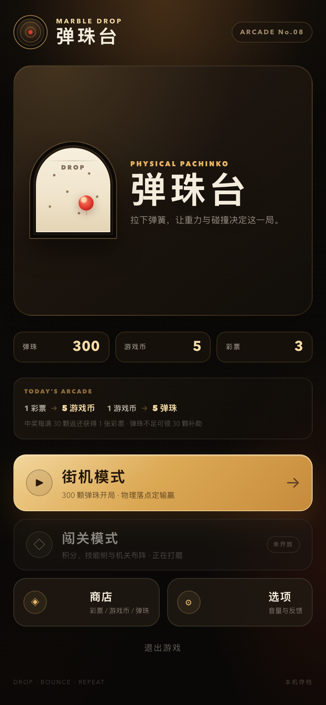

## 当前状态

- **街机模式**：已开放。新账号从 **300 颗弹珠** 开始，投入 5–99 颗弹珠，靠实际物理落点决定输赢。
- **闯关模式**：按钮保留但锁定，显示「未开放」。之前的积分、技能树和机关布阵原型代码仍在仓库内部，但街机入口不挂载；也可从 Git 历史回溯。
- **商店**：已开放彩票 / 游戏币 / 弹珠兑换，母球皮肤与弹珠台机台的购买和装备。
- **弹珠台机台**：5 台机台可购买 / 切换。「橡木经典」免费；「黄昏电玩」14 彩票；「霓虹都市」28 彩票；「虫洞实验室」40 彩票；「狂赌深渊」58 彩票。基础投注与奖槽规则共享；狂赌深渊的中央轮盘会额外改写倍率和彩票。
- **障碍物引擎**：支持沿路径循环移动、主动常转 / 被动受击旋转、碰撞弹射、双向传送门、静态方块和感应式转盘六类障碍物。
- **母球皮肤**：6 款皮肤，用彩票解锁；同时改变母球外观、速度拖尾、碰撞粒子和发射 / 碰撞音效，不影响物理属性。
- **选项**：音效音量、静音、触感反馈、中奖吐珠动画、玩法说明和重置存档。
- **退出**：进入退出页并尝试关闭页面；浏览器通常会阻止自动关闭标签页，页面会提示手动关闭或重新进入。

## 运行

项目没有运行时第三方依赖，使用原生 ES Modules。**必须通过 HTTP 打开**，不能直接双击 `index.html`（浏览器会阻止模块加载）。

```bash
npm start
```

然后打开 <http://127.0.0.1:4173/>。

没有 npm 时也可以：

```bash
python3 -m http.server 4173 --bind 127.0.0.1
```

开发检查：

```bash
npm run check
```

## 街机模式

1. 投入 5–99 颗弹珠，按「开始游戏」。
2. 随机抽出本局倍率并点亮中奖槽位：
   - ×2：4 个奖槽
   - ×4：3 个奖槽
   - ×6：2 个奖槽
   - ×8：1 个奖槽
   - ×10：1 个奖槽
3. 限位器打开，母球落入右下发射舱。
4. 按住弹簧把手向下拖动，松手发射。力度条 0–100% 线性对应发射速度。
5. 母球落入 12 个槽位之一；落入亮灯槽即返还「投入 × 倍率」颗弹珠。
6. 中奖后播放吐珠动画：返还多少颗，就有多少颗弹珠从黄铜吐珠管落进托盘，每颗都有独立重力、托盘碰撞和落珠音效。
7. 托盘里的弹珠全部落定后，动画淡出并显示本局结算卡片。轻触机台可提前跳过动画。
8. 每满 30 颗返还弹珠，额外获得 1 张彩票。
9. 母球沿回球坡道回到限位器，进入下一局。
10. 装备「狂赌深渊」时，落入中央轮盘的母球会被吞入，按转盘结果改写本局倍率、彩票和追加球，然后从轮心随机角度重新射出。轮盘不是必中区域，落点也可能完全避开它。

吐珠动画可以在「选项 → 中奖吐珠动画」关闭，关闭后中奖会直接显示结算卡片。

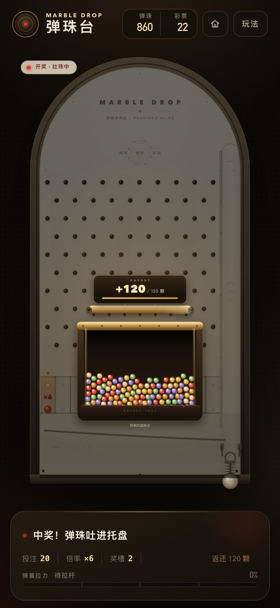

发球前可以使用右上角的房子按钮返回主界面（本局结束后才能返回）。

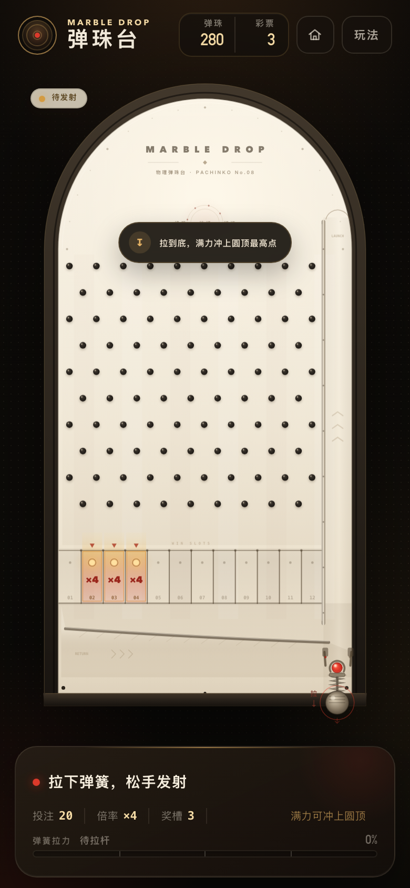

## 街机经济

| 项目 | 规则 |
| --- | --- |
| 初始弹珠 | 300 颗 |
| 彩票来源 | 每次中奖返还，每满 30 颗获得 1 张 |
| 彩票 → 游戏币 | 1 张彩票 = 5 游戏币 |
| 游戏币 → 弹珠 | 1 游戏币 = 5 颗弹珠 |
| 免费补助 | 弹珠不足 5 颗，且游戏币和彩票都为 0 时，可领取 30 颗 |
| 母球皮肤 | 12–36 张彩票，购买后自动装备，只改变表现 |
| 弹珠台机台 | 14 / 28 / 40 / 58 张彩票，购买后自动装备；狂赌深渊另有轮盘规则 |

主界面、商店、游戏内低余额提示都可以进入补助流程。游戏币只通过彩票兑换获得，并且只用于购买弹珠；机台与皮肤都用彩票解锁。

## 弹珠台机台

机台是比母球皮肤更重度的解锁内容：除了机台外观、机柜造型和棋盘布局不同，每台机台还会挂载独立的障碍物配方。机台用彩票购买，购买后立即装备，下一局生效；切换机台不会重置街机账号、彩票或皮肤。

| 机台 | 价格 | 造型与障碍物 |
| --- | --- | --- |
| 橡木经典 · OAK CLASSIC | 免费 | 温润纸面、对称 10/9 钉阵、黄铜回球坡道 |
| 黄昏电玩 · DUSK ARCADE | 14 彩票 | 低矮复古机柜、三排普通霓虹钉阵；一台缓慢单层巡逻车、一块常转招牌和两块每局随机换位的全息广告牌。机关更少，落点更直白 |
| 霓虹都市 · NEON CITY | 28 彩票 | 深色科技机柜；最上层 12 枚闪烁霓虹分流钉；中层两列飞行汽车各两辆，分别循环左→右和右→左；第三层 5 栋参差摩天楼与楼顶霓虹灯牌 |
| 虫洞实验室 · WARP LAB | 40 彩票 | 梯形科技顶盖；两台主动转子、一台被动三叶转子、两枚弹射桩和一对左右相连的传送门 |
| 狂赌深渊 · ABYSS WAGER | 58 彩票 | 尖顶红丝绒机柜；中央十二格命运轮盘、左右对称的双转子、成对弹性侧护栏、大 / 小传送门与三枚赌场筹码弹射桩 |

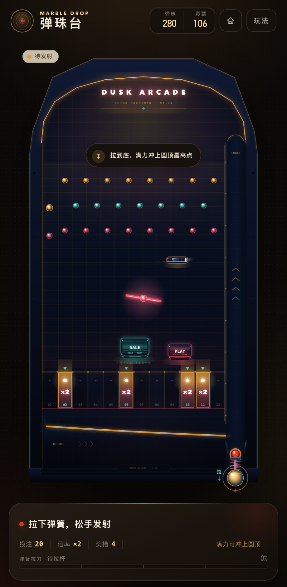

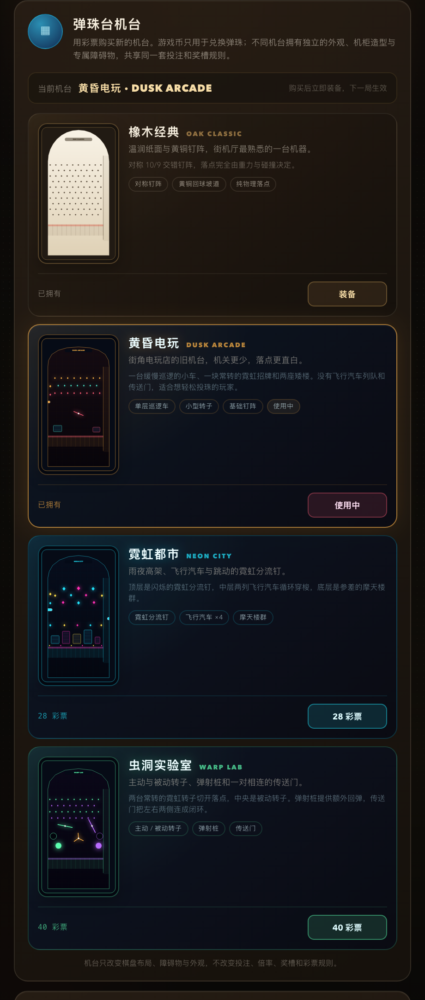

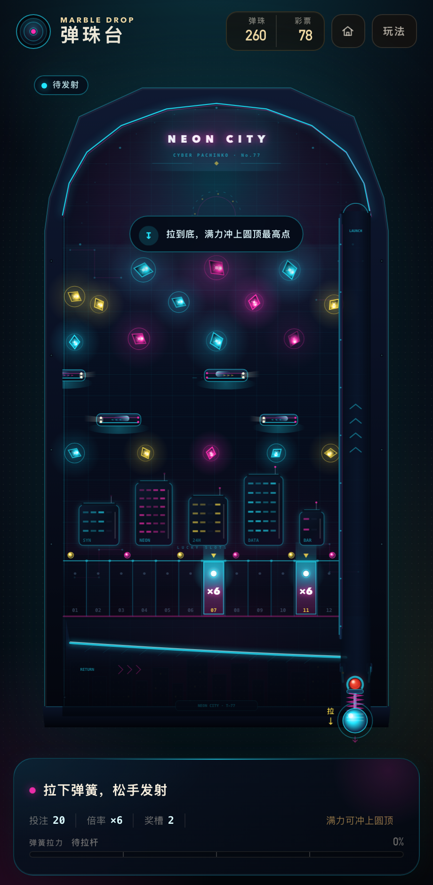

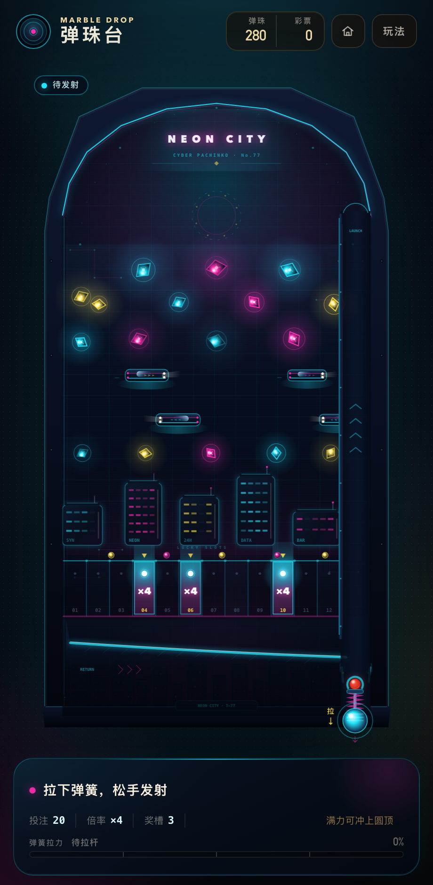

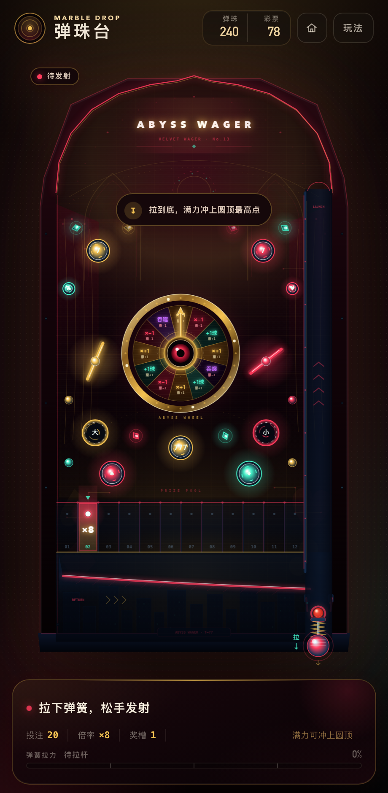

除「狂赌深渊」的轮盘外，机台只改变棋盘布局、障碍物和视觉表现，不改变投注范围、倍率表、奖槽数量、彩票规则和母球物理参数。狂赌深渊仍使用相同的投注和奖槽，但轮盘可以临时加减倍率、增减彩票并追加赌球。购买和装备状态保存在本机账号里。

### 狂赌深渊 · 中央命运轮盘

轮盘由 12 个扇区组成，分布为 4 个加注、3 个抽水、3 个追加球和 2 个吞噬：

| 结果 | 概率 | 效果 |
| --- | --- | --- |
| 倍率 +1 | 4 / 12 | 本局倍率 +1（封顶 ×20），彩票 +1 |
| 倍率 -1 | 3 / 12 | 本局倍率 -1（最低 ×1），彩票 -1 |
| 追加一球 | 3 / 12 | 彩票 +1，并从轮心生出一颗额外赌球；额外球独立落入奖槽，按当前倍率计分后销毁 |
| 深渊吞噬 | 2 / 12 | 彩票 -1，母球立即被摧毁，本局结束 |

- 母球触碰轮盘范围就会被暂时隐藏，指针随后旋转并停在抽中的扇区。
- 结算后，母球从轮盘中心以随机角度重新发射；轮盘在短暂冷却后才会再次生效。
- 轮盘可以连续触发，但吞噬会直接终结当前球；追加球也会计入本局返还与彩票，同一时间最多存在 4 颗。
- 轮盘不是必中区域：它占中央一部分台面，母球可以从上方、侧面或底部绕开。

霓虹都市的平衡经过落点模拟调整：靠左侧的边轨分流钉会截住贴轨下落的母球，摩天楼之间留出六条街道，楼间缺口下方再放置路灯分流钉，避免母球总是从同一个缺口落入 3 号槽。0.5–0.86 力度下模拟覆盖 10 个槽位，最高单槽命中率约 21%，没有卡球或超时。

## 障碍物引擎

`src/game/tables.js` 用可序列化的配方描述机台：拱顶轮廓、钉子布局、发射随机偏移和障碍物列表。`src/game/obstacles.js` 负责把配方实例化为运行时对象，完成运动、碰撞、音效事件与 Canvas 绘制。

| 类型 | 行为 |
| --- | --- |
| `mover` | 沿折线路径循环移动，可设置速度、相位和「只与主棋盘碰撞」；飞行汽车到达边缘后从另一侧重新进入 |
| `rotor` | 主动转子以固定角速度常转；被动转子接受碰撞冲量，按转动惯量加速并逐渐阻尼 |
| `bumper` | 碰撞后沿法线施加额外弹力，弹力按相对撞击速度缩放，可带标签和独立颜色 |
| `portal` | 一对相连的入口 / 出口；进入一侧后从另一侧出现，保留速度并带冷却与离开重置，避免瞬间来回传送 |
| `block` | 静态圆角方块，可带屋顶随机弹射、霓虹窗格和楼顶标识；用于摩天楼、箱体等 |
| `wheel` | 感应式转盘，不参与刚体碰撞；首次触碰触发事件，带指针动画、扇区结果、冷却与重新武装 |

所有移动 / 旋转障碍物都会计算 **相对表面速度**：飞行汽车可以把母球推开，被动转子会被偏心的母球撞得转起来，而不是只做视觉动画。障碍物在每帧更新，物理仍以 240Hz 子步执行。

## 商店

- 彩票换游戏币
- 游戏币购买 5 颗 / 25 颗弹珠
- 弹珠台机台：5 台，用彩票解锁，购买后立即装备
- 母球皮肤：6 款，用彩票解锁，可随时装备和试听

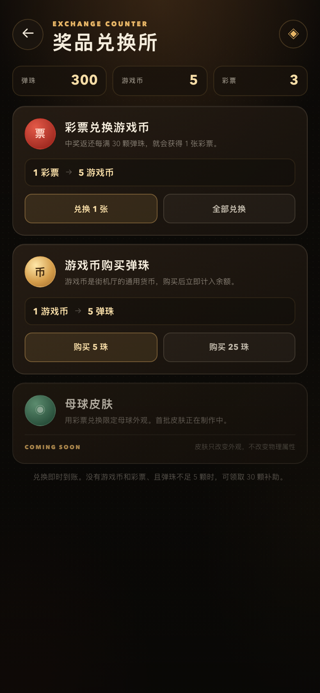

## 母球皮肤

母球皮肤是纯外观系统：只改变表现，不参与物理计算，因此不会影响落点或中奖概率。

| 皮肤 | 价格 | 表现 |
| --- | --- | --- |
| 红宝石 | 默认拥有 | 红玻璃、暖色碎光、清脆碰撞 |
| 鎏金 | 12 彩票 | 金色条纹、金属火花、黄铜余韵 |
| 青玉 | 12 彩票 | 青玉斑点、气泡拖尾、木质轻叩 |
| 潮蓝 | 20 彩票 | 深海圆环、水滴碰撞、丝带拖尾 |
| 霓虹 | 28 彩票 | 电弧纹样、电流星火、霓虹拖尾 |
| 曜夜 | 36 彩票 | 星尘纹样、低频回响、深空拖尾 |

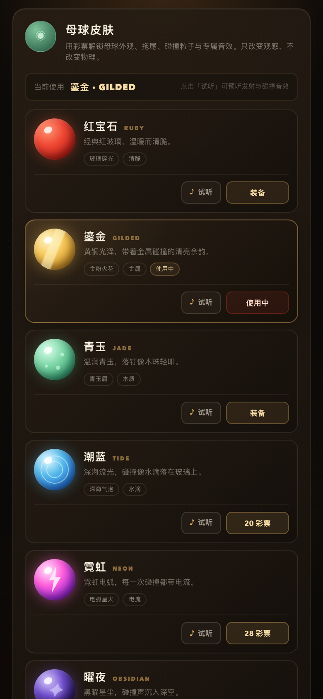

每款皮肤控制 5 个表现通道：

- **母球外观**：渐变、纹理和光晕
- **速度拖尾**：点状 / 线状 / 气泡 / 星火 / 丝带
- **碰撞粒子**：钉子与机台边缘粒子的颜色和形状
- **发射音效**：拉杆释放时的合成音色
- **碰撞音效**：钉子与墙面碰撞时的合成音色

商店里可以「试听」每款皮肤，购买后自动装备；已拥有的皮肤可随时切换。皮肤定义集中在 `src/game/skins.js`，商店、渲染和音频共用同一份数据。

## 选项

- 音效音量滑杆（0–100%）
- 静音开关
- 触感反馈开关
- 中奖吐珠动画开关（默认开启；关闭后中奖直接显示结算）
- 玩法说明
- 重置本地存档

设置、街机账号、母球皮肤与机台解锁状态会保存在 `marble-drop-account-v2`。账号存档版本为 4；缺少机台字段的旧账号会自动补全「橡木经典」，不会丢失已有弹珠、游戏币、彩票或皮肤。新版账号首次创建时从 300 颗弹珠开始，不会读取旧版 `marble-drop-save-v1` 的挑战进度。

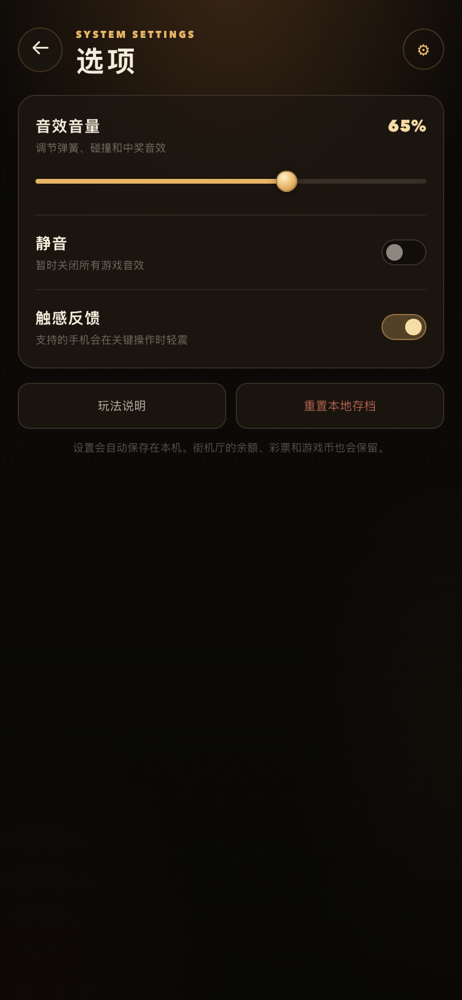

## 在线部署

站点通过 GitHub Actions 发布到 GitHub Pages。`.github/workflows/pages.yml` 会：

1. 检出 `main`
2. 把 `index.html` 和 `src/` 复制到静态站点目录
3. 上传 Pages artifact 并发布

推送到 `main` 会自动触发部署，也可以在 Actions 页面手动运行 `Deploy GitHub Pages`。

GitHub Pages 的项目站点地址为：

<https://pepe-2026-coder.github.io/marble-drop/>

## 工程结构

```text
.
├── index.html                 多屏 HTML 壳
├── src/
│   ├── main.js                主界面 / 商店 / 选项 / 路由
│   ├── account.js             街机账号、货币和设置持久化
│   ├── audio.js               音效与触感（共享设置）
│   ├── game/
│   │   ├── engine.js          Canvas 游戏流程、物理、渲染与机台切换
│   │   ├── tables.js          弹珠台目录：价格、拱顶、钉子布局与障碍物配方
│   │   ├── obstacles.js       障碍物运行时：移动、旋转、弹射、传送与碰撞
│   │   ├── cyberpunk.js       霓虹都市 / 虫洞实验室的机柜、槽位与弹簧渲染
│   │   ├── tablePreview.js    商店机台缩略图渲染
│   │   ├── payout.js          中奖吐珠动画与托盘物理
│   │   ├── skins.js           母球皮肤目录：外观、拖尾、粒子、音效与价格
│   │   ├── config.js          棋盘几何与物理常量
│   │   └── utils.js           数学工具
│   ├── ui/
│   │   └── toast.js           共享 Toast
│   └── styles/
│       ├── game.css           游戏机台与 HUD 样式
│       └── shell.css          主界面 / 商店 / 选项 / 退出样式
├── scripts/
│   ├── serve.mjs              无依赖静态服务器
│   └── check.mjs              JavaScript 语法检查
├── package.json
├── jsconfig.json
├── preview*.png
└── README.md
```

### 源码与 Git

项目已使用 Git 管理，提交按「基线 / 工程化与经济 / 文档」拆分。挑战模式原型代码仍在仓库内部但未挂载到当前街机入口，后续重构后再开放。分支与合并规则见下方「开发流程」。

```bash
git log --oneline
git status
```

## 开发流程

`main` 是唯一长期分支，**始终可部署、可发布**。所有新功能、修复和文档改动都走功能分支，合并进 `main` 前必须先通过验收。这样可以保证多个功能并行开发时，各自改动互不覆盖，`main` 上也不会出现半成品冲突。

```text
① 同步 main ─► ② 切出功能分支 ─► ③ 开发 + 自测 ─► ④ 维护者验收 ─► ⑤ 合并回 main ─► ⑥ 推送 GitHub
                                                            （并行功能各走各自的 ②–④，互不干扰）
```

### 1. 开发前先同步主分支

每次开始新功能前，都要从远端拉取最新的 `main`，避免在过期的代码上开工：

```bash
git switch main
git pull --ff-only origin main
```

如果工作区有未提交的改动，先提交到当前功能分支，或 `git stash` 暂存后再同步，不要在脏工作区上切分支。

### 2. 从 `main` 分出功能分支

```bash
git switch -c feature/功能名
```

- 分支必须从最新的 `main` 切出，不要从其他功能分支再分叉。
- 命名约定：`feature/` 新功能、`fix/` 修复、`docs/` 文档、`chore/` 配置与工具。名称用短横线连接，例如 `feature/daily-challenge`、`fix/payout-lag`。
- 一个分支只做一件事。多个功能并行时各开各的分支，互不共享分支。

### 3. 在功能分支上开发

```bash
npm run check        # 提交前必须通过
npm start            # 本地 127.0.0.1:4173 手动验证
git add -A
git commit -m "feat: 简要说明"
```

提交信息沿用 `feat:` / `fix:` / `docs:` / `chore:` / `ci:` 前缀。开发期间可以多次提交，也可以在功能分支上直接推送备份（`git push -u origin feature/功能名`）。

### 4. 提交验收

功能完成后，把分支状态交给项目维护者验收：

```bash
git switch main
git pull --ff-only origin main
git switch feature/功能名
git rebase main          # 先对齐主分支，提前解决冲突
npm run check
git push -u origin feature/功能名
```

验收内容包括：`npm run check` 通过、本地实际运行无报错、功能符合预期、没有顺带改动无关文件。**验收通过之前不合并、不推送 `main`。**

### 5. 验收通过后合并进 `main` 并推送

```bash
git switch main
git pull --ff-only origin main
git merge --no-ff feature/功能名 -m "merge: 功能说明"
npm run check
git push origin main
```

推送 `main` 会触发 GitHub Pages 部署。合并后再确认一次线上地址可以正常打开。

也可以改用 Pull Request：把功能分支推送到 GitHub 后开 PR，由维护者 review 通过再点 Merge，流程和效果与上面的本地合并不变。

### 6. 收尾

```bash
git branch -d feature/功能名                 # 删除本地分支
git push origin --delete feature/功能名      # 删除远端分支
```

### 分支规则

- 禁止直接在 `main` 上开发或提交；`main` 只接受验收通过后的合并，以及发布相关的必要改动。
- 同一时间存在多个功能分支时，先合并的先对齐 `main`；后合并的分支在验收前重新 `rebase main`，冲突在功能分支内解决。
- 功能分支上的提交可以整理（`rebase -i`），合并进 `main` 的历史保持一次合并提交。
- 合并前发现主线已有相关改动，以 `main` 为准调整功能分支，不要用强制推送覆盖他人提交。
- 建议在 GitHub 仓库设置中为 `main` 开启分支保护（禁止直接 push、合并前要求 PR 审核），让流程由平台兜底，避免误操作。

## 技术说明

- Canvas 2D + 自研 2D 物理，固定 240Hz 物理子步。
- 渲染分成两层：机柜、钉阵、奖槽壳体、台标、回球坡道和发射道这些从不移动的元素，在切换机台或改变画布尺寸时烘焙进一张静态图层；每帧只重绘亮灯奖槽、碰撞辉光、限位器、弹簧、障碍物、母球和粒子。
- Canvas 后备缓冲最多按 2 倍设备像素渲染（手机 DPR 3 时像素量降低约 55%）；没有交互时降到 30fps，离开游戏界面或切到后台会完全暂停 `requestAnimationFrame`。机台阴影改用静态图层，游戏界面内的 `backdrop-filter` 已移除，避免在动画画布上方每帧做模糊。
- 中奖吐珠是一个独立的轻量物理场景：托盘尺寸随返还数量变化，落定的弹珠合并进缓存图层，990 颗的满额中奖也能保持流畅。
- 左右对称 10/9 交错钉阵，避免单侧畅通或堵死。
- 力度线性映射，满力可到达圆顶最高点。
- 母球皮肤使用统一的 `skins.js` 数据源：渲染层、粒子系统和 WebAudio 合成器分别读取同一份定义，皮肤不参与物理计算。
- 机台使用统一的 `tables.js` 数据源：物理层读取拱顶、钉子和障碍物配方；渲染层读取主题色与机台外观。机台切换只重建棋盘，不重置账号。
- 「狂赌深渊」的轮盘是 `wheel` 感应障碍物：引擎在触碰时隐藏主球、抽取扇区并播放指针动画，结算后从轮心随机发射。额外赌球使用独立的轻量物理循环，忽略轮盘感应，落入奖槽后立即销毁并合并进本局结果。
- 黄昏电玩使用 `retro` 变体：保留少量机关和更简洁的机柜背景，作为低价入门机台；霓虹都市和虫洞实验室则是完整机关配置。它的两块全息广告牌通过 `randomX` 在每局开始时重新投影到随机街道位置，不会固定遮住同一组奖槽。
- 圆形 / 胶囊 / 有向圆角矩形的碰撞都考虑障碍物表面速度；被动转子额外使用冲量力矩和阻尼，移动汽车可把母球推走。
- 传送门带冷却、进入 / 离开重置和目标点速度保留，避免同一帧内反复传送。
- 账号存档升级到 version 4，新增机台已拥有 / 当前装备字段；旧账号会自动补全默认机台。
- 轮盘结果直接进入统一的本局结算：主球落点、追加球返还、轮盘彩票和倍率修正会合并成一张结果卡。
- 街机、商店、选项、退出为独立屏幕，共享账号与音频模块。
- 无构建步骤、无运行时第三方依赖。

## 后续计划

- 重新设计闯关模式的积分、技能树和机关平衡，完成后开放。
- 继续扩充母球皮肤，并加入活动限定 / 稀有度外观。
- 增加更多机台：倾斜棋盘、可破坏方块、多段传送链和组合式转子。
- 继续打磨狂赌深渊的轮盘节奏、命中率和额外球经济。
- 每日挑战、胜场 / 最高返还记录。
- 更多街机厅设置项和可访问性选项。
